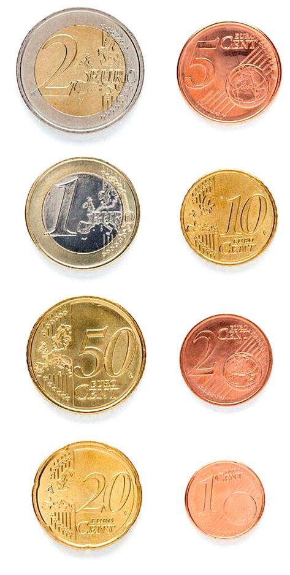
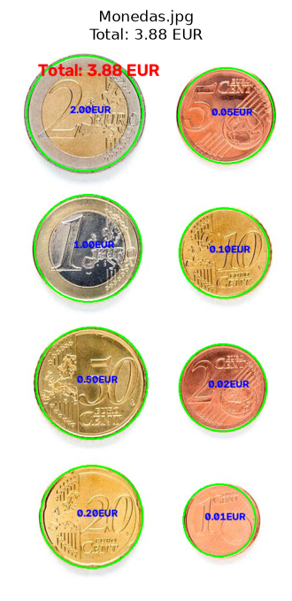
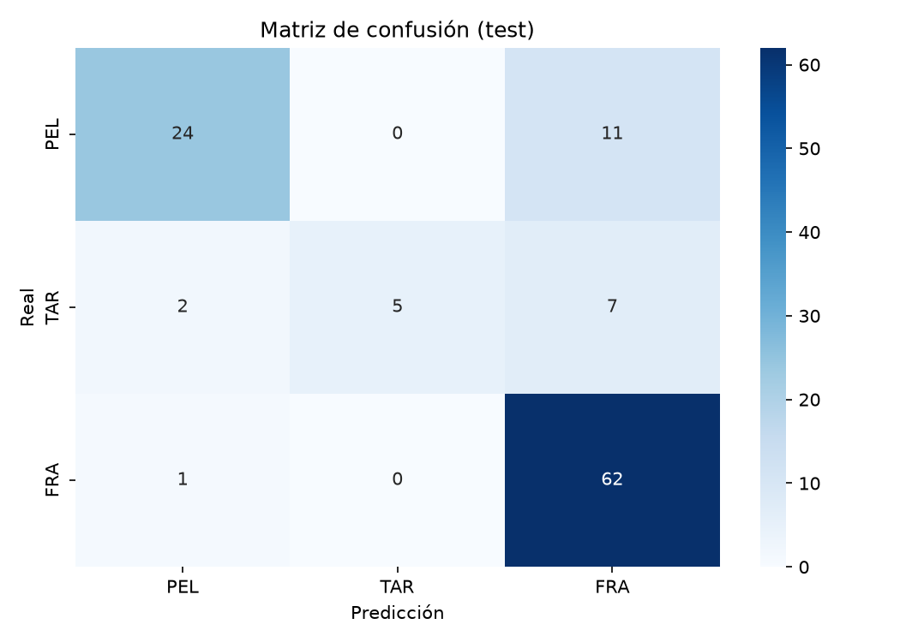

# Descripción

Este repositorio contiene una serie de ejercicios prácticos realizados en Python utilizando la biblioteca OpenCV, enfocados en el procesamiento y manipulación de imágenes. Las tareas desarrolladas incluyen:

- Contador de monedas tanto en imágenes como en una demo en vivo (se ha utilizado 'IP webcam' del móvil).
- Clasificador heurístico de partículas.

Cada celda del [cuaderno](/p3/P3_Tareas.ipynb) está comentada para explicar su propósito y facilitar la comprensión del código.

# Contenido

En esta práctica se desarrollaran dos tareas distintas. Antes de realizarlas se importaran las siguientes librerías:

```py
import cv2  
import numpy as np
import matplotlib.pyplot as plt
import csv
from collections import deque

import pandas as pd
from sklearn.ensemble import RandomForestClassifier
from sklearn.metrics import confusion_matrix, classification_report
import seaborn as sns
```

### **Primera Tarea**: Los ejemplos ilustrativos anteriores permiten saber el número de monedas presentes en la imagen ideal proporcionada. ¿Cómo determinar la cantidad de dinero presente en ella? A partir únicamente de las dimensiones, una sugerencia impicaríaj en primer término identificar de forma interactiva (por ejemplo haciendo clic en la imagen) una moneda de un valor fijo en la imagen (por ejemplo de 1€) para permitir establecer una relación entre píxeles y mo¡ilímetros. Tras obtener esa información y las dimensiones en milímetros de las distintas monedas, es factible calcular la cantidad de dinero en la imagen ideal.

### Una vez resuelto el reto con la imagen ideal proporcionada, diseña un demostrador en vivo que a partir de la entrada de vídeo de la cámara, determine el dinero presente en la escena. Si bien no hay restricciones sobre utilizar medidas geométricas o de color, o cualquier clasificador, no deben hacer uso de modelos de aprendizaje profundo. ¿Funciona correctamente? ¿Se observan problemas? Posibles extras serían la presencia de objetos que no son monedas y/o haya solape entre las monedas.

### IMPORTANTE: No se admite el uso de modelos de aprendizaje profundo

### Nota: Para establecer la correspondencia entre píxeles y milímetros, comentar que la moneda de un euro tiene un diámetro de 23.25 mm. la de 50 céntimos de 24.35, la de 20 céntimos de 22.25, etc.

Para empezar el ejercicio necesitamos cargar la imagen que vamos a usar para reconocer las monedas. Usamos una función para redimensionar la imagen.

```py
# cargar imagen de monedas
img = cv2.imread("Monedas.jpg")
if img is None:
    raise IOError("No se pudo cargar Monedas.jpg")
```



Siendo la imagen ideal para conseguir una perfecta relación de diámetro entre las monedas, lo que permitirá diferenciar entre ellas.

A continuación se presenta la función usada para redimensionar esta imagen sin perder las condiciones.

```py
def redimensionar_imagen(img, ancho_max=800):
    alto, ancho = img.shape[:2]
    if ancho > ancho_max:
        escala = ancho_max / ancho
        nuevo_ancho = int(ancho * escala)
        nuevo_alto = int(alto * escala)
        img_redim = cv2.resize(img, (nuevo_ancho, nuevo_alto))
        return img_redim
    else:
        return img
```

Introduciendo una escala se ajusta el tamaño de la imagen para su correcta visualización.

Antes de poder seleccionar la moneda de referencia, hace falta detectar todas las monedas presentes en la imagen. Para ello se usa la transformada de Hough para círculos (`cv2.HoughCircles`), que busca en la imagen en escala de grises (con un suavizado con `medianBlur` para reducir ruido) formas circulares dentro de un rango de radios:

```py
gray = cv2.cvtColor(img, cv2.COLOR_BGR2GRAY)
gray = cv2.medianBlur(gray, 5)

circles = cv2.HoughCircles(
    gray, cv2.HOUGH_GRADIENT, dp=1, minDist=50,
    param1=100, param2=45, minRadius=25, maxRadius=100
)
if circles is None:
    raise ValueError("No se detectaron monedas en la imagen.")
circles = np.uint16(np.around(circles))
```

`minDist` evita que dos círculos muy próximos se detecten como el mismo; `minRadius`/`maxRadius` acotan el tamaño esperado de una moneda en píxeles (hay que ajustarlos según la resolución de la imagen); `param2` controla cuánto de "circular" tiene que verse algo para aceptarlo — bajarlo detecta más círculos pero también más falsos positivos.

Una vez detectadas, se dibujan todas sobre la imagen para verlas antes de elegir la referencia:

```py
for (x, y, r) in circles[0, :]:
    cv2.circle(img_display, (x, y), r, (0, 255, 0), 2)
    cv2.circle(img_display, (x, y), 2, (0, 0, 255), 3)
```

Con las monedas ya localizadas, se pide al usuario que indique **cuál de ellas es la de 1€**, haciendo clic sobre ella. La función `seleccionar_moneda` se engancha a los eventos de ratón de la ventana de OpenCV mediante `cv2.setMouseCallback`:

```py
ref_diametro_mm = 23.25
escala_mm_px = None
ref_pos = None

def seleccionar_moneda(event, x, y, flags, param):
    nonlocal escala_mm_px, ref_pos, img_display
    if event == cv2.EVENT_LBUTTONDOWN:
        distancias = [np.sqrt((x - cx)**2 + (y - cy)**2) for (cx, cy, _) in circles[0, :]]
        idx = np.argmin(distancias)
        (cx, cy, r) = circles[0][idx]
        ref_pos = (cx, cy)
        diametro_ref_px = 2 * r
        escala_mm_px = ref_diametro_mm / diametro_ref_px
        print(f"Moneda de referencia seleccionada en ({cx}, {cy}), radio {r}px")
        img_display[:] = img.copy()
        for (x0, y0, r0) in circles[0, :]:
            cv2.circle(img_display, (x0, y0), r0, (0, 255, 0), 2)
        cv2.circle(img_display, (cx, cy), r, (0, 0, 255), 3)
```

En vez de exigir que el usuario haga clic exactamente en el centro, se calcula la distancia del punto pulsado a cada círculo detectado y se queda con el más cercano (`np.argmin`), así basta con hacer clic en cualquier parte de la moneda. Con el radio en píxeles de esa moneda y sabiendo que un 1 € mide realmente 23.25 mm de diámetro, se obtiene el factor de conversión `escala_mm_px` (milímetros que representa cada píxel), que es la clave de todo el método: a partir de aquí, medir el radio en píxeles de cualquier otra moneda permite saber su diámetro real en milímetros.

La ventana se mantiene abierta hasta que se hace el clic (o se pulsa ESC para cancelar):

```py
cv2.namedWindow("Selecciona moneda de referencia")
cv2.setMouseCallback("Selecciona moneda de referencia", seleccionar_moneda)
while escala_mm_px is None:
    cv2.imshow("Selecciona moneda de referencia", img_display)
    if cv2.waitKey(1) & 0xFF == 27:
        break
cv2.destroyAllWindows()

if escala_mm_px is None:
    raise ValueError("No se seleccionó ninguna moneda de referencia.")
```

Con la escala ya calculada, solo queda clasificar cada moneda detectada. Se define una tabla con el diámetro real (mm) de cada denominación de euro y su valor correspondiente:

```py
monedas_info = {
    16.25: 0.01, 18.75: 0.02, 19.75: 0.10, 21.25: 0.05,
    22.25: 0.20, 23.25: 1.00, 24.25: 0.50, 25.75: 2.00
}
```

Aunque el enunciado ponía de ejemplo que la moneda de 50cent era de 24.35mm se ha cambiado a 24.25mm dado que muchas veces reconocía la de 2€ como de 50cent.

Para cada moneda detectada, se convierte su radio en píxeles a milímetros con la escala ya calculada, y se busca en la tabla el diámetro real más cercano (`min(..., key=lambda d: abs(d - diametro_mm))`), asignándole así su valor:

```py
total = 0
resultado = img.copy()
for (x, y, r) in circles[0, :]:
    diametro_mm = 2 * r * escala_mm_px
    diametro_real = min(monedas_info.keys(), key=lambda d: abs(d - diametro_mm))
    valor = monedas_info[diametro_real]
    total += valor
    cv2.circle(resultado, (x, y), r, (0, 255, 0), 2)
    cv2.putText(resultado, f"{valor:.2f}EUR", (x - 25, y),
                cv2.FONT_HERSHEY_SIMPLEX, 0.6, (255, 0, 0), 2)
cv2.putText(resultado, f"Total: {total:.2f} EUR", (50, 50),
            cv2.FONT_HERSHEY_SIMPLEX, 1, (0, 0, 255), 3)
```

Finalmente, se muestra el resultado con `matplotlib` (convirtiendo de BGR a RGB, ya que OpenCV y matplotlib usan órdenes de color distintos):

```py
resultado1, total1 = procesar_monedas(img)

plt.figure(figsize=(8, 8))
plt.imshow(cv2.cvtColor(resultado1, cv2.COLOR_BGR2RGB))
plt.axis("off")
plt.title(f"Monedas.jpg\nTotal: {total1:.2f} EUR")
plt.show()
```



**Demo en vivo:** Una vez resulto el problema con la imagen ideal, se adapta el mismo esquema a un flujo de vídeo en directo. Dos diferencias importantes respecto a la imagen fija:

- La calibración no puede detener el programa esperando un único clic: el vídeo tiene que seguir corriendo, y el usuario hace clic sobre la moneda de 1 € **en cualquier momento** mientras lo ve.
- La medida del radio de cada moneda varía ligeramente de un fotograma a otro por ruido en la detección (iluminación, vibración de la cámara, etc.). Si se clasificara con el radio de cada fotograma por separado, una misma moneda podría "saltar" entre denominaciones parecidas (por ejemplo entre 1€ y 50 cent, que solo difieren 1 mm de diámetro). Para evitarlo, cada moneda se *sigue* de un fotograma a otro y se usa la mediana de sus últimos radios en vez del valor instantáneo.

Como fuente de vídeo se usó la cámara del móvil en vez de la del portátil, conectando ambos a la misma red WiFi con la app **IP Webcam** (Android), que expone la cámara como una URL de vídeo:

```py
cap = cv2.VideoCapture("http://192.168.1.78:8080/video")  # IP del móvil con IP Webcam
```

*(Con la webcam del propio portátil bastaría con `cv2.VideoCapture(0)`.)*

La detección de monedas se encapsula en una función para reutilizarla en cada fotograma:

```py
def detectar_monedas(frame):
    gray = cv2.cvtColor(frame, cv2.COLOR_BGR2GRAY)
    gray = cv2.medianBlur(gray, 5)
    circles = cv2.HoughCircles(
        gray, cv2.HOUGH_GRADIENT, dp=1, minDist=50,
        param1=100, param2=45, minRadius=25, maxRadius=100
    )
    if circles is None:
        return None
    return np.uint16(np.around(circles))[0, :]
```

Para suavizar la medida, cada moneda detectada se empareja con la más cercana (por posición) del fotograma anterior, de forma que se le pueda ir acumulando un historial de sus últimos radios:

```py
N_HISTORIAL = 15  # fotogramas que se promedian por moneda

def actualiza_tracks(circles, tracks, siguiente_id, max_dist=40):
    nuevos_tracks = {}
    usados = set()
    if circles is None:
        return nuevos_tracks, siguiente_id
    for (x, y, r) in circles:
        mejor_id, mejor_dist = None, max_dist
        for tid, info in tracks.items():
            if tid in usados:
                continue
            cx, cy = info["pos"]
            d = np.hypot(int(x) - cx, int(y) - cy)
            if d < mejor_dist:
                mejor_dist, mejor_id = d, tid
        if mejor_id is None:
            mejor_id = siguiente_id
            siguiente_id += 1
            historial = deque(maxlen=N_HISTORIAL)
        else:
            usados.add(mejor_id)
            historial = tracks[mejor_id]["radios"]
        historial.append(int(r))
        nuevos_tracks[mejor_id] = {"pos": (int(x), int(y)), "radios": historial}
    return nuevos_tracks, siguiente_id
```

Cada moneda ("track") guarda una cola (`deque`) de tamaño fijo con sus últimos radios; al llenarse, el más antiguo se descarta automáticamente. Clasificar con la **mediana** de ese historial (en vez de la media) hace que detecciones puntuales muy erróneas no desplacen el resultado.

La calibración por clic funciona igual que con la imagen fija, pero ahora recibe en cada fotograma la lista de círculos detectados *en ese instante* (no el historial suavizado), ya que para calibrar interesa el clic sobre una detección concreta:

```py
ref_diametro_mm = 23.25   # moneda de referencia: 1 euro
escala_mm_px = None

def seleccionar_moneda(event, x, y, flags, circles):
    global escala_mm_px
    if event == cv2.EVENT_LBUTTONDOWN and circles is not None and len(circles) > 0:
        distancias = [np.sqrt((x - cx) ** 2 + (y - cy) ** 2) for (cx, cy, r) in circles]
        idx = np.argmin(distancias)
        cx, cy, r = circles[idx]
        escala_mm_px = ref_diametro_mm / (2 * r)
        print(f"Calibrado con moneda en ({cx},{cy}), radio {r}px -> {escala_mm_px:.4f} mm/px")
```

Y finalmente, el bucle principal en donde en cada fotograma se detectan las monedas, se actualiza el seguimiento, y se clasifica (y dibuja) cada una usando la mediana de su historial, pero solo si ya tiene al menos 5 fotogramas acumulados (si no, se dibuja en amarillo sin valor, para no mostrar una cifra poco fiable nada más aparecer la moneda en la imagen):

```py
cap = cv2.VideoCapture("http://192.168.1.78:8080/video")
cv2.namedWindow("Dinero en vivo")

tracks = {}
siguiente_id = 0

while True:
    ret, frame = cap.read()
    if not ret:
        break

    circles = detectar_monedas(frame)
    cv2.setMouseCallback("Dinero en vivo", seleccionar_moneda, circles)
    tracks, siguiente_id = actualiza_tracks(circles, tracks, siguiente_id)

    display = frame.copy()
    total = 0
    for tid, info in tracks.items():
        x, y = info["pos"]
        if len(info["radios"]) < 5:
            cv2.circle(display, (x, y), int(np.median(info["radios"])), (0, 200, 200), 2)
            continue
        r_suave = np.median(info["radios"])
        cv2.circle(display, (x, y), int(r_suave), (0, 255, 0), 2)

        if escala_mm_px is not None:
            diametro_mm = 2 * r_suave * escala_mm_px
            diametro_real = min(monedas_info.keys(), key=lambda d: abs(d - diametro_mm))
            valor = monedas_info[diametro_real]
            total += valor
            cv2.putText(display, f"{valor:.2f}", (x - 20, y),
                        cv2.FONT_HERSHEY_SIMPLEX, 0.6, (255, 0, 0), 2)

    if escala_mm_px is not None:
        cv2.putText(display, f"Total: {total:.2f} EUR", (20, 30),
                    cv2.FONT_HERSHEY_SIMPLEX, 0.9, (0, 0, 255), 2)
    else:
        cv2.putText(display, "Haz clic sobre la moneda de 1 euro para calibrar",
                    (20, 30), cv2.FONT_HERSHEY_SIMPLEX, 0.6, (0, 0, 255), 2)

    cv2.imshow("Dinero en vivo", display)
    if cv2.waitKey(20) & 0xFF == 27:   # ESC
        break

cap.release()
cv2.destroyAllWindows()
```


Cosas a tener en cuenta:

- Dos denominaciones con diámetros muy próximos (1€/50cent, o 2€/1€) son fáciles de confundir tanto al elegir la referencia como en la propia clasificación. El suavizado por mediana ayuda con el ruido de un fotograma a otro, pero no corrige un error de calibración de base.
- Los parámetros de `HoughCircles` (`param1`, `param2`, rango de radios) dependen de la resolución y distancia de la cámara. Con el móvil como fuente de vídeo hubo que volver a ajustarlos respecto a los que funcionaban con la imagen fija.
- El método no distingue monedas solapadas entre sí (Hough puede llegar a fusionarlas en una sola detección) ni descarta explícitamente objetos circulares que no sean monedas.

### **Segunda Tarea**: La tarea consiste en extraer características (geométricas y/o visuales) de las tres imágenes completas de partida, y *aprender* patrones que permitan identificar las partículas en nuevas imágenes. Para ello se proporciona como imagen de test *MPs_test.jpg* y sus correspondientes anotaciones *MPs_test_bbs.csv* con la que deben obtener las métricas para su propuesta de clasificación de microplásticos, además de la matriz de confusión. La matriz de confusión permitirá mostrar para cada clase el número de muestras que se clasifican correctamente de dicha clase, y el número de muestras que se clasifican incorrectamente como perteneciente a una de las otras dos clases. De nuevo, no deben hacer uso de modelos de aprendizaje profundo ni para segmentar, ni para clasificar.

### En el trabajo [SMACC: A System for Microplastics Automatic Counting and Classification](https://doi.org/10.1109/ACCESS.2020.2970498), las características geométricas utilizadas fueron:

### - Área en píxeles

### - Perímetro en píxeles

### - Compacidad (relación entre el cuadrado del perímetro y el área de la partícula)

### - Relación del área de la partícula con la del contenedor

### - Relación del ancho y el alto del contenedor

### - Relación entre los ejes de la elipse ajustada

### - Definido el centroide, relación entre las distancias menor y mayor al contorno

### IMPORTANTE: No se admite el uso de modelos de aprendizaje profundo

Para esta segunda tarea se dispone de tres imágenes de entrenamiento, una por clase (pellets `PEL`, alquitrán `TAR` y fragmentos `FRA`), y de una imagen de test (`MPs_test.jpg`) con sus anotaciones (`MPs_test_bbs.csv`). Además de estas tres, se usan tres imágenes adicionales (`PEL.png`, `TAR.png` y `FRA.png`), una por clase, para ampliar el conjunto de entrenamiento.


```py
TRAIN = {
    'PEL': ['pellet-03-olympus-10-01-2020.JPG'],
    'TAR': ['tar-03-olympus-10-01-2020.JPG'],
    'FRA': ['fragment-03-olympus-10-01-2020.JPG'],
}
TRAIN['PEL'].append('PEL.png')
TRAIN['TAR'].append('TAR.png')
TRAIN['FRA'].append('FRA.png')
 
CLASSES = ['PEL', 'TAR', 'FRA']
CONTRASTS = [1.0, 0.8, 0.6]
GEOMS = [(0, False), (1, False), (2, False), (3, False), (0, True), (1, True)]
WIDTH = 1170
```

El enfoque no usa aprendizaje profundo en ningún paso: la segmentación es procesamiento clásico de imagen (OpenCV), las características se calculan a mano y el clasificador es un `RandomForestClassifier` de scikit-learn.

El proceso tiene cinco pasos: **normalizar** la resolución, **segmentar** las partículas, **extraer características** de cada una, **entrenar** el clasificador (con aumentación de datos y validación cruzada) y **evaluar** sobre la imagen de test.

Las características de tamaño (área, perímetro) y los parámetros de la segmentación (por ejemplo, el tamaño del filtro de mediana que estima el fondo) dependen de la resolución de la imagen. Para que todas las imágenes de entrenamiento y de test sean comparables, se reescalan a un ancho común (`WIDTH = 1170` px) antes de procesarlas. En el test, las cajas del CSV se multiplican por el mismo factor de escala para que sigan coincidiendo con las partículas.

```py
def normalize(img, width=WIDTH):
    # reescala a un ancho común. devuelve imagen y factor de escala
    s = width / img.shape[1]
    if abs(s - 1) < 1e-6:
        return img, 1.0
    return cv2.resize(img, (width, int(round(img.shape[0] * s))), interpolation=cv2.INTER_AREA), s
```

Gracias a esto se pueden usar el área y el perímetro en píxeles que propone SMACC, ya que ahora tienen el mismo significado en todas las imágenes.

Un primer intento con la binarización típica (escala de grises + `THRESH_OTSU`) dio malos resultados. En la imagen de pellets detectaba más de 100 contornos cuando hay unos 60, porque el fondo no es uniforme (hay viñeteo y sombras en los bordes de la foto) y los fragmentos claros tienen poco contraste en gris.

Por eso se segmenta con la diferencia respecto al fondo local en el espacio de color Lab. El fondo se estima con un filtro de mediana de gran tamaño, que elimina las partículas (pequeñas) y se queda con la iluminación de fondo (de variación lenta). Después se calcula la distancia de color de cada píxel a ese fondo, y se binariza con Otsu:

```py
def background(lab):
    # estimación del fondo: mediana grande por canal (las partículas desaparecen)
    return np.stack([cv2.medianBlur(lab[:, :, i], 101) for i in range(3)], -1).astype(np.float32)
 
def segment(img):
    lab = cv2.cvtColor(img, cv2.COLOR_BGR2LAB)
    d = np.sqrt(((lab.astype(np.float32) - background(lab)) ** 2).sum(-1))   # distancia al fondo
    d8 = np.clip(cv2.GaussianBlur(d, (5, 5), 0) * 10, 0, 255).astype(np.uint8)
    _, m = cv2.threshold(d8, 0, 255, cv2.THRESH_BINARY + cv2.THRESH_OTSU)
    m = cv2.morphologyEx(m, cv2.MORPH_OPEN, np.ones((3, 3), np.uint8))    # elimina ruido
    return cv2.morphologyEx(m, cv2.MORPH_CLOSE, np.ones((5, 5), np.uint8))  # cierra huecos
```

Al medir diferencia de color y no brillo, funciona tanto con partículas oscuras (alquitrán) como claras (fragmentos blancos) o de color. Con esta máscara se obtienen contornos con `cv2.findContours` (`RETR_EXTERNAL`) y se descartan los de menos de 20 píxeles de área en entrenamiento (10 en test), considerados polvo y ruido.

Para cada contorno se calculan las características geométricas del trabajo SMACC, junto con algunas visuales (color):

| Característica | Tipo | Cálculo |
|---|---|---|
| Tamaño | SMACC | √área (px, a resolución normalizada) |
| Perímetro | SMACC | `cv2.arcLength` (px, a resolución normalizada) |
| Compacidad | SMACC | perímetro² / área |
| Área / área del contenedor | SMACC | área / (ancho · alto) del `boundingRect` |
| Ancho / alto del contenedor | SMACC | min(w, h) / max(w, h) |
| Relación de ejes de la elipse | SMACC | eje menor / eje mayor de `cv2.fitEllipse` |
| Distancias al centroide | SMACC | distancia mínima / máxima del contorno al centroide |
| Solidez | geométrica | área / área del casco convexo |
| Circularidad | geométrica | 4π · área / perímetro² |
| Luminosidad relativa | visual | L media de la partícula / L del fondo |
| ΔA, ΔB y croma | visual | color medio de la partícula menos el del fondo (Lab) |
| Saturación | visual | S media (HSV) |

Dos decisiones de diseño:

- Se usa la raíz del área en lugar del área directamente para que la característica crezca de forma lineal con el tamaño de la partícula y no domine por su escala.
- La relación ancho/alto del contenedor se define como `min(w, h) / max(w, h)` en lugar de `w / h`. Con `w / h`, girar una partícula 90° invertiría el valor, aunque la partícula sea la misma. De esta forma la característica es invariante a esos giros.

```py
mask = np.zeros(img.shape[:2], np.uint8)
cv2.drawContours(mask, [c], -1, 255, -1)                       # máscara de la partícula
mean = np.array(cv2.mean(lab, mask)[:3])                       # color medio (Lab)
b = np.array([bg[..., i][mask > 0].mean() for i in range(3)])  # color del fondo bajo la partícula
dA, dB = (mean - b)[1:]                                        # color RELATIVO al fondo
```

El color se mide relativo al fondo y no en valor absoluto, para que no dependa de la iluminación de la foto.

Hay pocas imágenes por clase, así que se amplía el conjunto de entrenamiento con dos tipos de aumentación aplicados a cada imagen completa antes de segmentarla:

- **Contraste** (`CONTRASTS`): copias con menos contraste, que simulan partículas más pálidas respecto al fondo.
- **Geométrica** (`GEOMS`): giros de 90°, 180°, 270° y espejos. Se usan solo múltiplos de 90° para no introducir bordes artificiales como ocurriría con rotaciones arbitrarias.

```py
def pale(img, k):
    return np.clip(255 - (255 - img.astype(np.float32)) * k, 0, 255).astype(np.uint8)
 
def transform(img, k, flip):
    out = np.rot90(img, k)
    if flip:
        out = out[:, ::-1]
    return np.ascontiguousarray(out)
```

Cada partícula de una variante aumentada se asocia con la partícula de la imagen original de la que procede, deshaciendo la transformación sobre su centroide (`inverse_point`). Este identificador se usa después como grupo para la validación cruzada.

El clasificador es un `RandomForestClassifier`; `class_weight='balanced'` compensa que hay más fragmentos que partículas de las otras clases:

```py
def new_model():
    return RandomForestClassifier(n_estimators=400, random_state=42,
                                  class_weight='balanced', min_samples_leaf=2, n_jobs=-1)
```

Número de partículas segmentadas en cada imagen de entrenamiento original (ya normalizada a `WIDTH`):

```md
PEL pellet-03-olympus-10-01-2020.JPG: 56 partículas (imagen original)
PEL PEL.png: 11 partículas (imagen original)
TAR tar-03-olympus-10-01-2020.JPG: 52 partículas (imagen original)
TAR TAR.png: 9 partículas (imagen original)
FRA fragment-03-olympus-10-01-2020.JPG: 75 partículas (imagen original)
FRA FRA.png: 15 partículas (imagen original)
```

Con la aumentación se obtienen 3762 muestras de entrenamiento.

**Validación cruzada.** Para evaluar el clasificador sin usar el test, se hace una validación cruzada de 5 particiones con `GroupKFold`, agrupando por partícula. Así, todas las variantes (giros, espejos, contraste) de una misma partícula caen en la misma partición. Sin agrupar, el modelo vería en validación la misma partícula que ya ha visto girada en entrenamiento, y el resultado sería artificialmente alto.

```md
              precision    recall  f1-score   support
 
         PEL       0.89      0.82      0.85      1182
         TAR       0.86      0.93      0.89      1086
         FRA       0.90      0.90      0.90      1494
 
    accuracy                           0.88      3762
   macro avg       0.88      0.88      0.88      3762
weighted avg       0.88      0.88      0.88      3762
```

En lugar de segmentar cada recorte por separado (el umbral de Otsu cambia en cada recorte), se segmenta la imagen de test completa con el mismo método y, para cada anotación del CSV, se toma el contorno más grande cuyo centroide cae dentro de la caja:

```py
tp = particles(img, MIN_AREA_TEST)
for _, r in ann.iterrows():
    ins = [i for i, (cx, cy, a, _) in enumerate(tp)
           if r.x_min <= cx <= r.x_max and r.y_min <= cy <= r.y_max]
    if not ins:
        miss += 1; continue                       # caja sin contorno: no se evalúa
    Xt.append(tp[max(ins, key=lambda i: tp[i][2])][3]); yt.append(r.label)
```

El test se usa una única vez, al final, solo para evaluar.

**Resultados:**

```md
112 partículas de test emparejadas; 8 bboxes sin contorno (no evaluadas)
              precision    recall  f1-score   support
 
         PEL       0.89      0.69      0.77        35
         TAR       1.00      0.36      0.53        14
         FRA       0.78      0.98      0.87        63
 
    accuracy                           0.81       112
   macro avg       0.89      0.68      0.72       112
weighted avg       0.84      0.81      0.80       112
```



Cada fila de la matriz es la clase real y cada columna la clase predicha, de modo que la diagonal son las partículas bien clasificadas y el resto son errores hacia las otras dos clases.

# Autoría

Este trabajo ha sido realizado por _Paula Lijun Nuez Hernández_ del grupo 25, como parte de una práctica de procesamiento de imágenes en el entorno académico.

# Bibliografía

Durante el desarrollo de la práctica se consultaron o utilizaron las siguientes fuentes:

- Documentación oficial de [OpenCV](https://docs.opencv.org)
- [Gemini](https://share.gemini.google/ulfSK26FxeZI)
