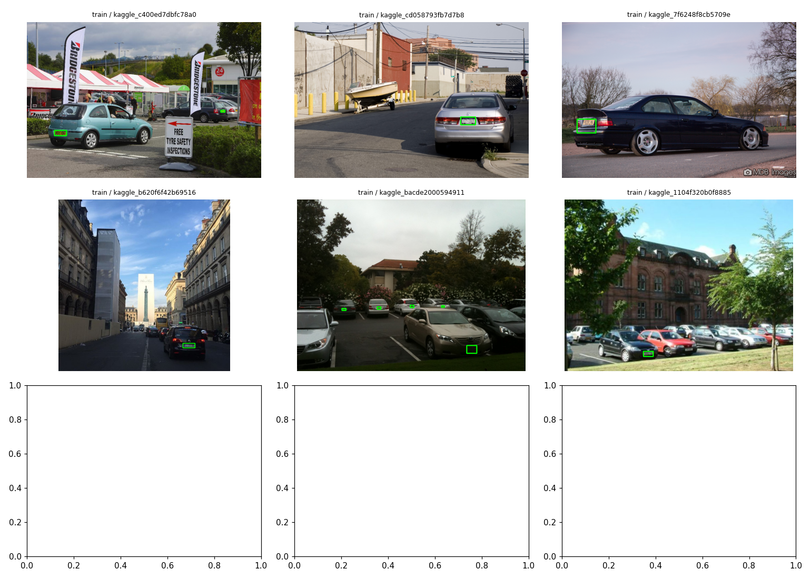
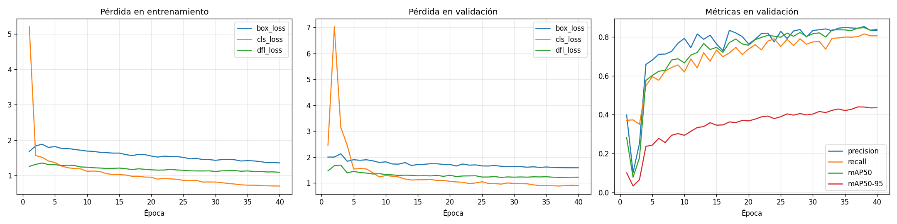
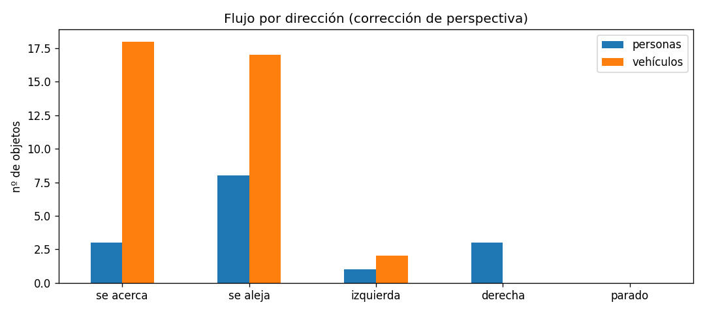
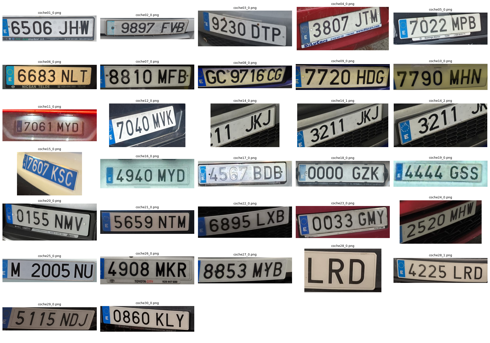
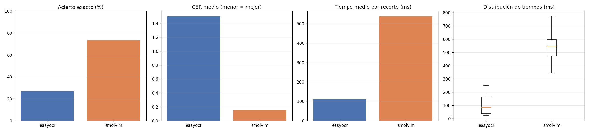
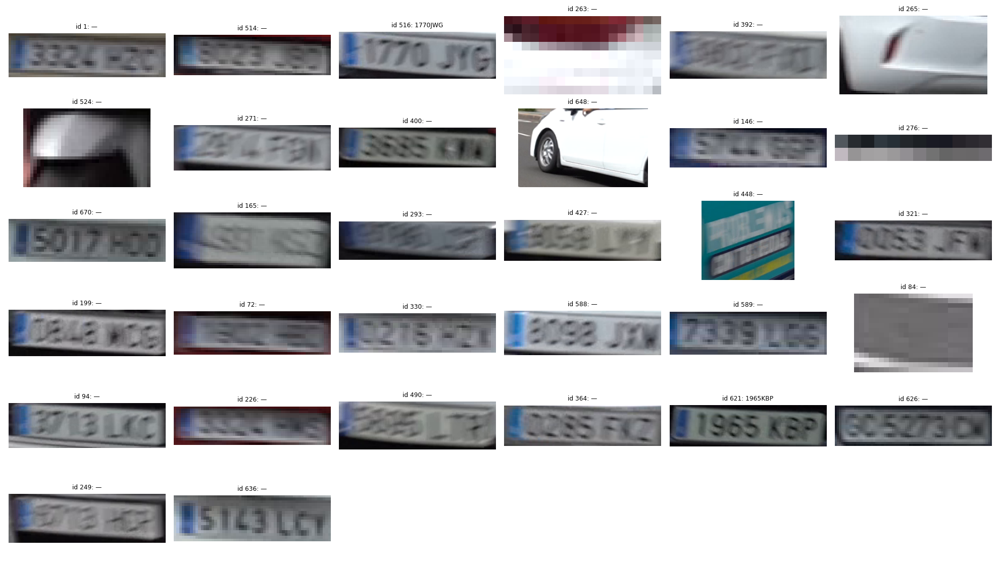

# Descripción

Este repositorio contiene la práctica 4 de Visión por Computador: un prototipo que procesa un vídeo para **detectar y seguir personas y vehículos**, **localizar sus matrículas**, **leer su texto** y **contar** el total de cada clase. Las tareas desarrolladas incluyen:

- Detección y seguimiento de personas y vehículos con YOLO11n + BoT-SORT (Ultralytics).
- Entrenamiento de un detector de matrículas propio (YOLO11n) con un conjunto de datos de Kaggle.
- Lectura del texto de las matrículas en el vídeo con un VLM (SmolVLM) y volcado a un `csv`.
- Comparativa entre un OCR clásico (EasyOCR) y un VLM (SmolVLM) en tiempo de inferencia y tasa de acierto.
- Extra: flujo de personas y vehículos por direcciones.

Todo el flujo está en un único [cuaderno](/p4/VC_P4.ipynb), ejecutado en Google Colab, con las celdas comentadas.

# Contenido

## Máquina de pruebas

Todos los tiempos de este documento se midieron en la misma máquina: **Google Colab**, GPU **NVIDIA Tesla T4** (14,9 GB), 13,6 GB de RAM, Python 3.13.16, PyTorch 2.14.1+cu130 y Ultralytics 8.4.208.

## Archivos de la entrega

| Archivo | Descripción |
|---|---|
| `VC_P4.ipynb` | Cuaderno completo con las salidas ejecutadas |
| `resultado.csv` | Detección y seguimiento por fotograma (7347 filas), con el texto de la matrícula |
| `resultado.mp4` | Vídeo de test con detecciones, seguimiento, matrículas y texto leído |
| `dataset_manifiesto.csv` | Lista exacta de las imágenes de Kaggle usadas para entrenar y validar |
| `imagenes/` | 30 fotos propias de matrículas |
| `ocr_dataset/` | Recortes de matrículas y `matriculas_texto.csv` (texto real escrito a mano) |
| `runs/detector_matriculas-2/` | Entrenamiento: `weights/best.pt`, `results.csv` y curvas |
| `resultados/` | Gráficas y tablas usadas en este documento |


[Resultado del vídeo](https://ulpgc-my.sharepoint.com/:v:/r/personal/paula_nuez103_alu_ulpgc_es/_layouts/15/stream.aspx?id=%2Fpersonal%2Fpaula_nuez103_alu_ulpgc_es%2FDocuments%2Fresultado.mp4&share=cQplK469uycPTIi2iJgbfj9dEgUDuP83xvjHzQUA9h8s79xXHw&nav=eyJyZWZlcnJhbEluZm8iOnsicmVmZXJyYWxBcHAiOiJPbmVEcml2ZUZvckJ1c2luZXNzIiwicmVmZXJyYWxBcHBQbGF0Zm9ybSI6IldlYiIsInJlZmVycmFsTW9kZSI6InZpZXciLCJyZWZlcnJhbFZpZXciOiJNeUZpbGVzTGlua0NvcHkifX0)

# Primera parte: detección, seguimiento y matrículas

Los modelos de YOLO preentrenados (COCO) detectan personas y vehículos, pero no matrículas, así que se entrena un detector propio a partir de `yolo11n.pt` (transfer learning).

Los datos utilizados para ello son los siguientes:

- **Kaggle:** [License Plate Detection Dataset](https://www.kaggle.com/datasets/fareselmenshawii/license-plate-dataset) (Fares Elmenshawii), con imágenes de Google Open Images y etiquetas YOLO de una clase. Tiene 4295 imágenes de train y 1073 de validación; se toma un subconjunto aleatorio (semilla 42) de **1500 imágenes de train** y **300 de validación**. La lista exacta está en `dataset_manifiesto.csv`.
- **Fotos propias:** 30 fotos de matrículas españolas. **No se anotaron**, por lo que no se usan para entrenar; se utilizan en la comparativa de OCR.
- **Limitación:** al no haber anotaciones propias no existe un conjunto de test con matrículas españolas, y la evaluación se hace sobre la validación de Kaggle.

El cuaderno convierte cualquier etiqueta de Kaggle a una única clase `matricula` y recrea la carpeta `dataset/` en cada ejecución para que no haya imágenes repetidas entre `train` y `val`. Muestras con sus cajas:



### Entrenamiento

```py
modelo = YOLO("yolo11n.pt")
modelo.train(data="dataset.yaml", epochs=40, imgsz=640, batch=16,
             device=0, patience=15, seed=42, workers=2)
```



La pérdida de entrenamiento baja de forma sostenida (`cls_loss` de ≈5,2 a ≈0,7 y `box_loss` de ≈1,7 a ≈1,35). En validación hay un pico de `cls_loss` en las primeras épocas (≈7 en la época 2), propio del arranque con *warm-up*, y después baja y se estabiliza en torno a 0,9. Las curvas de entrenamiento y validación no se separan, así que no hay señales de sobreajuste. Las métricas mejoran rápido hasta la época ~17 y después más despacio, con una meseta entre las épocas 30 y 40. La mejor época fue la 37 y el *early stopping* no llegó a activarse.

| | Precisión | Recall | mAP50 | mAP50-95 |
|---|---|---|---|---|
| Mejor época (`results.csv`, época 37) | 0,845 | 0,802 | 0,845 | 0,440 |
| Validación con `conf=0,25` (300 img, 434 matrículas) | 0,845 | 0,806 | 0,789 | 0,412 |

El mAP50 (≈0,8) indica que casi siempre encuentra la matrícula, pero el mAP50-95 (≈0,4) es mucho menor. Las cajas no están muy ajustadas. Se nota en los recortes, que a veces incluyen rótulos del concesionario o cortan parte de la matrícula. La inferencia tarda 3,9 ms por imagen en la T4. Como `best.pt` se elige con la validación, las métricas son algo optimistas (no hay test independiente).

## Detección y seguimiento en el vídeo

El vídeo se procesa fotograma a fotograma con el detector general (clases COCO: persona, bicicleta, coche, moto, autobús y camión) y el seguimiento BoT-SORT que incorpora Ultralytics:

```py
for n_frame, r in enumerate(detector.track(source=str(VIDEO_LOCAL), stream=True, persist=True,
                                           classes=list(CLASES), conf=0.3, device=DEVICE)):
    ...
```

En vez de buscarlas en todo el fotograma, el detector de matrículas se aplica al **recorte de cada vehículo** (así la matrícula ocupa más píxeles) y las coordenadas se devuelven al sistema de referencia del fotograma. Sólo se busca en vehículos con matrícula (no bicicletas) y de al menos 60 px de alto:

```py
rm = det_mat.predict(frame[y1:y2, x1:x2], imgsz=640, conf=0.3, verbose=False)[0]
...
mx1, my1, mx2, my2 = p + x1, q + y1, s + x1, t + y1
```

De cada vehículo se guardan sus 3 mejores recortes de matrícula, puntuados por confianza, tamaño y nitidez (varianza del Laplaciano). Así el OCR se aplica sólo a las vistas más favorables, en lugar de leer cada fotograma:

```py
puntuacion = cm * np.sqrt(alto * ancho) * np.log1p(nitidez)
```

 Para no contar objetos que no son reales, sólo se cuentan los *tracks* que cumplen dos condiciones: que duren al menos 15 fotogramas y se desplazan (≥ 10 % del ancho del vídeo en vehículos y ≥ 5 % en personas), lo que descarta coches aparcados e identificadores rotos. La clase de cada *track* es la más frecuente entre sus detecciones, porque a veces un coche se confunde con un camión en algún fotograma.

### Resultados

Se procesaron 2832 fotogramas; el seguimiento generó 59 identificadores y 42 cumplieron las condiciones.

| Clase | Total |
|---|---|
| Personas | 11 |
| Coches | 28 |
| Autobuses | 1 |
| Motos | 1 |
| Bicicletas | 1 |
| **Vehículos (total)** | **31** |

_Los conteos no se han validado manualmente fotograma a fotograma: si el seguimiento cambia de identificador a un mismo objeto, ese objeto puede contarse dos veces._

### Salida: `csv` y vídeo

El `csv` (`resultado.csv`, 7347 filas) tiene una fila por objeto contado y fotograma, con el formato sugerido en el enunciado:

```
fotograma, tipo_objeto, confianza, identificador_tracking, x1, y1, x2, y2,
matricula_en_su_caso, confianza_matricula, mx1, my1, mx2, my2, texto_matricula
```

En el vídeo se dibujan la caja y el identificador de cada objeto, la matrícula detectada, el texto leído sobre ella y un contador acumulado de personas y vehículos.

## Opción extra: flujo por direcciones

Se compara la posición media del objeto en sus primeros y últimos fotogramas y se clasifica la dirección dominante de su movimiento:

```py
dx, dy = c[-5:].mean(axis=0) - c[:5].mean(axis=0)
if abs(dx) >= abs(dy):
    return "hacia la derecha" if dx > 0 else "hacia la izquierda"
```

| | Hacia la derecha | Hacia la izquierda |
|---|---|---|
| Personas | 9 | 2 |
| Vehículos | 5 | 26 |



# Segunda parte: texto de las matrículas y comparativa de OCR

## Dataset de OCR

Para medir el acierto hace falta el texto verdadero de cada matrícula. Los recortes se generan con el detector entrenado sobre las 30 fotos propias (con un 10 % de margen en la caja): encontró matrícula en 29 de las 30 fotos (falló en `coche13.jpg`) y, al haber fotos con varias cajas, se obtuvieron **32 recortes**. De ellos, se escribió a mano el texto de **30** (`ocr_dataset/matriculas_texto.csv`). Como los recortes los genera el detector, algunos incluyen texto ajeno a la matrícula (rótulos del concesionario) o la cortan parcialmente.



## Comparativa entre el OCR clásico (EasyOCR) y el VLM (SmolVLM-500M)

- **EasyOCR:** OCR tradicional que localiza el texto y lo reconoce, restringido a letras mayúsculas y números.
- **SmolVLM-500M-Instruct:** modelo de visión y lenguaje al que se le pide, con el prompt _"Read the license plate in the image. Answer only with the plate characters, no spaces and no other text."_, decodificación determinista y fp16.

Ambos tenían las mismas condiciones: mismos 30 recortes, misma máquina y GPU, un recorte cada vez, 3 recortes de calentamiento que no se cuentan y mismo normalizado del texto (mayúsculas, sólo letras y números). Para las metricas: acierto exacto, CER (distancia de Levenshtein dividida por la longitud real; puede superar 1 si el OCR añade caracteres) y tiempo de inferencia por recorte.

| Motor | Acierto exacto | CER medio | Tiempo medio | Mediana | p95 | img/s |
|---|---|---|---|---|---|---|
| EasyOCR | 26,7 % (8/30) | 1,50 | 109 ms | 83 ms | 228 ms | 9,14 |
| SmolVLM-500M | **73,3 % (22/30)** | **0,15** | 538 ms | 542 ms | 670 ms | 1,86 |



### Conclusiones de la comparativa

- **Acierto:** SmolVLM acierta casi 3 veces más (73 % frente a 27 %) y su CER es 10 veces menor.
- **Por qué falla EasyOCR:** lee todo el texto visible, no sólo la matrícula. En muchos recortes devuelve la matrícula correcta **más** el rótulo del concesionario o las pegatinas (p. ej. `E6506JHW` seguido de `CONCESIONARIO…`), de ahí un CER medio superior a 1. El texto correcto suele estar dentro de la salida, así que filtrar por tamaño de letra mejoraría mucho su resultado; no se ha aplicado para comparar los modelos tal cual.
- **Errores del VLM:** con frecuencia devuelve sólo el bloque de letras (`JHW` en lugar de `6506JHW`, `JTM` en lugar de `3807JTM`) o lecturas incorrectas (`GBZ` por `0000GZK`). También penaliza que algunos recortes cortan parte de la matrícula (`coche14_0`).
- **Velocidad:** EasyOCR es unas 5 veces más rápido (109 ms frente a 538 ms; 9,1 frente a 1,9 img/s). Para el vídeo basta con leer unos pocos recortes por vehículo, así que el VLM es asumible.
- **Elección:** por precisión, el motor usado en el vídeo es SmolVLM.

## Texto de las matrículas en el vídeo

De cada vehículo contado se leen sus 3 mejores recortes con SmolVLM (previa ampliación con interpolación bicúbica si miden menos de 240 px de ancho). Se corrigen confusiones típicas entre letras y cifras (O/0, I/1...) sólo si el resultado tiene el formato nuevo `1234ABC`, y **únicamente se acepta un texto que tenga formato de matrícula española** (`1234ABC` o el antiguo `GC1234CG`). Entre las lecturas válidas se elige la más frecuente. Es preferible dejar la casilla vacía antes que escribir en el `csv` una lectura sin sentido.

```py
PATRON_NUEVO = re.compile(r"^\d{4}[BCDFGHJKLMNPRSTVWXYZ]{3}$")      # 1234ABC
PATRON_ANTIGUO = re.compile(r"^[A-Z]{1,2}\d{4}[A-Z]{1,2}$")         # GC1234CG
```

**Resultado:** de los 30 vehículos con matrícula, se detectó la matrícula en **29**, pero se obtuvo un texto válido sólo en **8** (27 %). Los recortes del vídeo son pequeños y están desenfocados (ancho mínimo 36 px, mediana 82 px, máximo 177 px), muy lejos de la calidad de las fotos de la comparativa, y ahí es donde el VLM falla.



# Autoría

Este trabajo ha sido realizado por [_Paula Lijun Nuez Hernández_](https://github.com/liezzz03) del grupo 25, como parte de una práctica de visión por computador en el entorno académico.

# Bibliografía

Durante el desarrollo de la práctica se consultaron o utilizaron las siguientes fuentes:

- Documentación oficial de [Ultralytics YOLO11](https://docs.ultralytics.com)
- [License Plate Detection Dataset](https://www.kaggle.com/datasets/fareselmenshawii/license-plate-dataset) (Kaggle, Fares Elmenshawii)
- [EasyOCR](https://github.com/JaidedAI/EasyOCR)
- [SmolVLM](https://huggingface.co/HuggingFaceTB/SmolVLM-500M-Instruct) (Hugging Face)
- Gemini como asistente a la redacción de la documentación.
