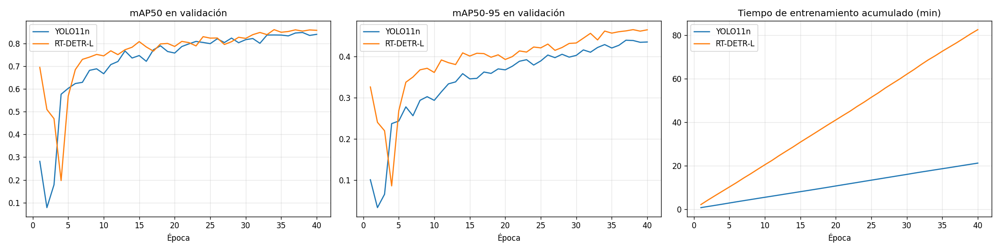
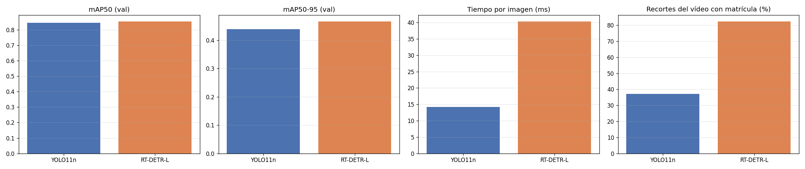
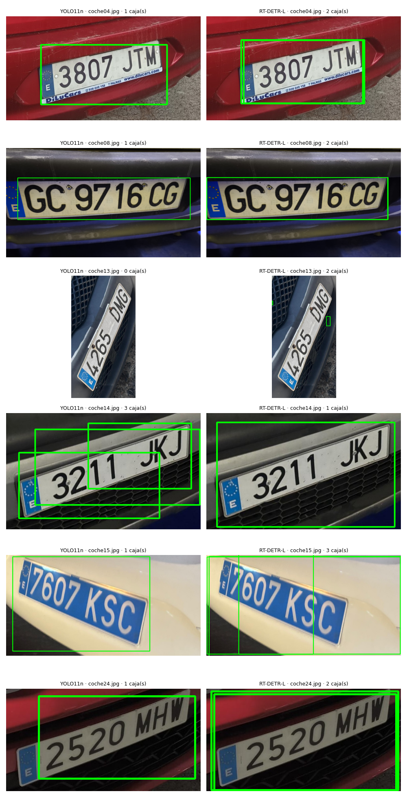
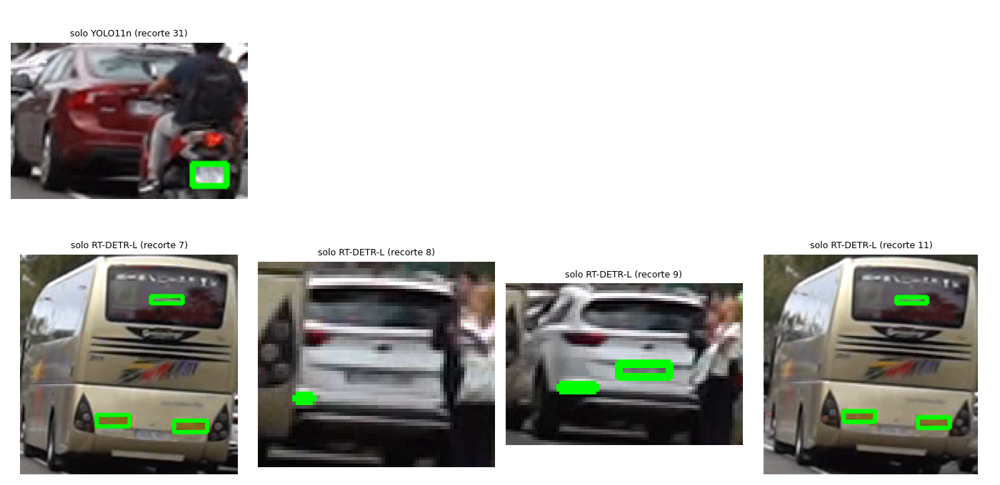
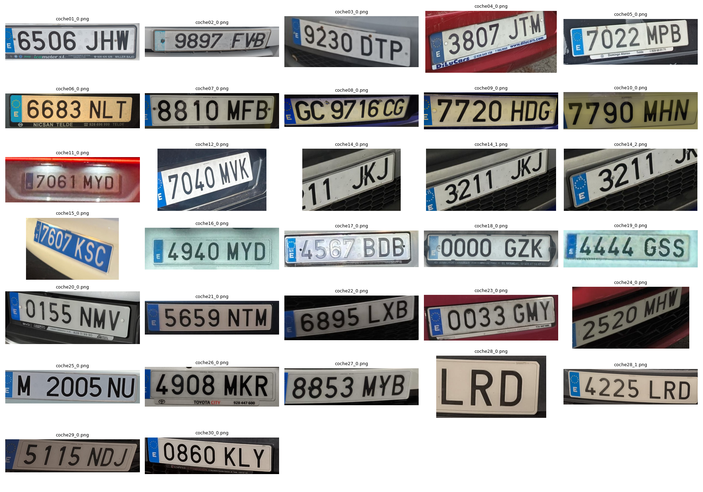

# Descripción

Este repositorio contiene la práctica 4 de Visión por Computador: un prototipo que procesa un vídeo para **detectar y seguir personas y vehículos**, **localizar sus matrículas**, **leer su texto** y **contar** el total de cada clase. Las tareas desarrolladas incluyen:

- Detección y seguimiento de personas y vehículos con YOLO11n + BoT-SORT (Ultralytics).
- Entrenamiento de un detector de matrículas propio con un conjunto de datos de Kaggle, con dos alternativas (**YOLO11n** y **RT-DETR-L**) que se comparan, y elección de la mejor para el vídeo.
- Lectura del texto de las matrículas en el vídeo por votación entre varios recortes y varios OCR (SmolVLM y EasyOCR filtrado), y volcado a un `csv`.
- Comparativa de tres motores de OCR en tiempo de inferencia y tasa de acierto: EasyOCR (clásico), EasyOCR filtrado y SmolVLM (VLM).
- **Validación manual** de las lecturas obtenidas en el vídeo, para medir el acierto real en recortes borrosos.
- Extras: comparación YOLO frente a RT-DETR, flujo de personas y vehículos por direcciones (con corrección de perspectiva) y anonimización del vídeo.

Todo el flujo está en un único [cuaderno](/p4/P4_Tareas.ipynb), ejecutado en Google Colab.

# Contenido

## Máquina de pruebas

Todos los tiempos de este documento se midieron en la misma máquina: **Google Colab**, GPU **NVIDIA Tesla T4** (14,9 GB), 13,6 GB de RAM, CPU x86_64, Python 3.13.16, PyTorch 2.14.1+cu130 y Ultralytics 8.4.212.

## Archivos de la entrega

| Archivo | Descripción |
|---|---|
| `P4_Tareas.ipynb` | Cuaderno completo con las salidas ejecutadas |
| `resultado.csv` | Detección y seguimiento por fotograma (9092 filas), con el texto de la matrícula |
| `resultado_comprimido.mp4` | Vídeo de test con detecciones, seguimiento, matrículas y texto leído (22,5 MB) |
| `resultado_anonimizado_comprimido.mp4` | Extra: el mismo vídeo con personas (cabeza) y matrículas desenfocadas (22,4 MB) |
| `dataset_manifiesto.csv` | Lista exacta de las imágenes de Kaggle usadas para entrenar y validar |
| `imagenes/` | 30 fotos propias de matrículas |
| `ocr_dataset/` | Recortes de matrículas y `matriculas_texto.csv` (texto real escrito a mano) |
| `runs/detector_matriculas-2/`, `runs/rtdetr_matriculas/` | Entrenamientos: `weights/best.pt`, `results.csv` y curvas |
| `resultados/` | Gráficas, tablas y resúmenes usados en este documento: `comparativa_detectores.csv`, `comparativa_ocr.csv`, `resumen_ocr.csv`, `validacion_video.csv`, `resumen_video.json` y `system_info.json` |

[Resultado del vídeo](resultado_comprimido.mp4) | [Vídeo anonimizado](resultado_anonimizado_comprimido.mp4)

Los vídeos originales (`resultado.mp4` y `resultado_anonimizado.mp4`) se comprimen con `ffmpeg` (`libx264`, `crf 28`) porque GitHub no admite archivos de más de 100 MB.

# Detector de matrículas

Los modelos de YOLO preentrenados (COCO) detectan personas y vehículos, pero no matrículas, así que se entrena un detector propio a partir de `yolo11n.pt` (transfer learning).

Los datos utilizados para ello son los siguientes:

- **Kaggle:** [License Plate Detection Dataset](https://www.kaggle.com/datasets/fareselmenshawii/license-plate-dataset) (Fares Elmenshawii), con imágenes de Google Open Images y etiquetas YOLO de una clase. Tiene 4295 imágenes de train y 1073 de validación; se toma un subconjunto aleatorio (semilla 42) de **1500 imágenes de train** y **300 de validación**. La lista exacta está en `dataset_manifiesto.csv`: si existe, el cuaderno reconstruye el conjunto idéntico a partir de él.
- **Fotos propias:** 30 fotos de matrículas españolas. **No se anotaron**, por lo que no se usan para entrenar; se utilizan en la comparativa de OCR y en una comprobación visual de los detectores.

El cuaderno convierte cualquier etiqueta de Kaggle a una única clase `matricula` y recrea la carpeta `dataset/` en cada ejecución para que no haya imágenes repetidas entre `train` y `val`.

### Entrenamiento de YOLO11n

```py
modelo = YOLO("yolo11n.pt")
modelo.train(data="dataset.yaml", epochs=40, imgsz=640, batch=16,
             device=0, patience=15, seed=42, workers=2)
```


La pérdida de entrenamiento baja de forma sostenida (`cls_loss` de ≈5,2 a ≈0,7 y `box_loss` de ≈1,7 a ≈1,35). En validación hay un pico de `cls_loss` en las primeras épocas (≈7 en la época 2), propio del arranque con *warm-up*, y después baja y se estabiliza en torno a 0,9. Las curvas de entrenamiento y validación no se separan, así que no hay señales de sobreajuste. Las métricas mejoran rápido hasta la época ~17 y después más despacio, con una meseta entre las épocas 30 y 40. La mejor época fue la 37 y el *early stopping* no llegó a activarse.

| | Precisión | Recall | mAP50 | mAP50-95 |
|---|---|---|---|---|
| Mejor época (`results.csv`, época 37) | 0,845 | 0,802 | 0,845 | 0,440 |
| Validación con `conf=0,25` (300 img, 434 matrículas) | 0,845 | 0,806 | 0,789 | 0,412 |

El mAP50 (≈0,8) indica que casi siempre encuentra la matrícula, pero el mAP50-95 (≈0,4) es mucho menor. Las cajas no están muy ajustadas. Se nota en los recortes, que a veces incluyen rótulos del concesionario o cortan parte de la matrícula. Como `best.pt` se elige con la validación, las métricas son algo optimistas (no hay test independiente).

## Opción extra: YOLO frente a RT-DETR para detectar matrículas

Se entrena un segundo detector de matrículas basado en **RT-DETR** (detector de Baidu construido con *Transformers*, publicado bajo licencia Apache 2.0) y se compara con YOLO11n. Se usa la implementación `RTDETR` de Ultralytics (modelo `rtdetr-l.pt`), de modo que el entrenamiento y la evaluación usan el mismo código y las mismas métricas que YOLO. RT-DETR-L se entrenó 40 épocas y su mejor época fue la 38.

### Condiciones del experimento

- **Mismos datos:** train (1500 imágenes) y validación (300) se reconstruyen a partir de `dataset_manifiesto.csv`, por lo que son idénticos a los de YOLO.
- **Mismos ajustes:** 40 épocas, `imgsz=640`, `patience=15`, semilla 42 y la misma GPU.
- **Evaluación repetida:** los dos modelos se evalúan con el mismo código sobre la misma validación (no se reutilizan métricas de entrenamientos anteriores).
- **Diferencias a tener en cuenta:**
  - **Tamaño:** RT-DETR-L tiene unas 12 veces más parámetros que YOLO11n, así que la comparación mezcla arquitectura y tamaño. Ultralytics sólo ofrece RT-DETR en versiones L y X, y no hay un YOLO de tamaño equivalente entrenado.
  - **Batch:** 8 en RT-DETR (por memoria) y 16 en YOLO.
  - **Licencia:** la clase `RTDETR` de Ultralytics está bajo AGPL-3.0, como el resto de la librería; la implementación original de Baidu es Apache 2.0, pero entrenarla exigiría convertir el dataset a formato COCO y configurar su propio entrenamiento.
  - **Una sola ejecución** por modelo (una semilla): las diferencias pequeñas pueden no ser significativas.

### Resultados en validación (300 imágenes, 434 matrículas)

| Modelo | Precisión | Recall | mAP50 | mAP50-95 |
|---|---|---|---|---|
| YOLO11n | **0,845** | 0,805 | 0,847 | 0,439 |
| RT-DETR-L | 0,828 | **0,855** | **0,854** | **0,466** |

Con `conf=0,25` (punto de trabajo realista) las diferencias en mAP aumentan: mAP50 de 0,789 (YOLO11n) frente a 0,844 (RT-DETR-L) y mAP50-95 de 0,412 frente a 0,458.

| Modelo | Parámetros (M) | GFLOPs | Peso `best.pt` | Tiempo por imagen | Imágenes/s | Entrenamiento |
|---|---|---|---|---|---|---|
| YOLO11n | 2,6 | 6,4 | 5,5 MB | 14,2 ms | 70,3 | 21,1 min |
| RT-DETR-L | 32,8 | 105,3 | 66,2 MB | 40,3 ms | 24,8 | 82,6 min |

_El tiempo por imagen incluye el preprocesado y el posprocesado (una imagen cada vez, desde fichero, tras 10 imágenes de calentamiento)._




### Fotos propias (30 matrículas españolas, sin anotar)

Con `conf=0,25`, YOLO11n devuelve una matrícula en 29 de las 30 fotos (falla en `coche13.jpg`, con la matrícula girada) y RT-DETR-L en 30 de 30, con mayor confianza media (0,865 frente a 0,720). Pero el 30/30 hay que matizarlo al mirar las cajas:

- En `coche13.jpg` las dos cajas de RT-DETR-L son pequeñas y no cubren la matrícula: en la práctica ningún modelo la encuentra.
- RT-DETR-L devuelve **cajas duplicadas** en varias fotos (`coche04`, `coche08`, `coche15`, `coche24`), porque no aplica supresión de no máximos.
- En `coche14.jpg`, YOLO11n da tres cajas parciales y RT-DETR-L una sola que cubre la matrícula.
- Ambos modelos dan cajas holgadas en primeros planos.



### Recortes de vehículos del vídeo

Se extraen **310 recortes** de vehículos de fotogramas repartidos por el vídeo (1 de cada 14) y se aplican los dos detectores a los mismos recortes (`conf=0,30`, como en el prototipo). Como no hay anotaciones no se puede medir la precisión: se mide la tasa de detección y el solape.

| Modelo | Recortes con matrícula | Tasa de detección | Confianza media | Tiempo por recorte |
|---|---|---|---|---|
| YOLO11n | 115 / 310 | 37,1 % | 0,602 | 11,8 ms |
| RT-DETR-L | 255 / 310 | 82,3 % | 0,632 | 40,8 ms |

| Ambos | Sólo YOLO11n | Sólo RT-DETR-L | Ninguno |
|---|---|---|---|
| 114 | 1 | 141 | 54 |



**Los ejemplos de desacuerdo muestran que una mayor tasa de detección no es una mayor precisión.** Parte de lo que sólo detecta RT-DETR-L son matrículas reales (por ejemplo, la trasera de un todoterreno blanco), pero otra parte son falsos positivos: el rótulo de la luna trasera de un autobús, los pilotos o una rueda. El único caso que sólo detecta YOLO11n es la matrícula de una moto.

### Análisis

- **Precisión:** RT-DETR-L mejora el recall (0,855 frente a 0,805, 5 puntos) y la localización (mAP50-95 de 0,466 frente a 0,439), con una precisión algo menor (0,828 frente a 0,845). Las diferencias son modestas, de una sola ejecución, y a `conf=0,25` el mAP50 gana 5,5 puntos.
- **Coste:** a cambio tiene unas 12 veces más parámetros, 16 veces más GFLOPs, un modelo 12 veces más pesado, casi 3 veces más latencia y casi 4 veces más tiempo de entrenamiento. Aun así, con unas 25 imágenes por segundo en la T4 sigue siendo de tiempo real.
- **Caso real (vídeo):** RT-DETR-L es mucho más sensible a matrículas pequeñas y borrosas, pero también genera falsos positivos, así que necesitaría un filtro posterior (por ejemplo, por proporciones de la caja).
- **Elección:** por el criterio de mayor mAP50-95 en validación, el detector usado en el vídeo es **RT-DETR-L**.

# Seguimiento, conteo y texto en el vídeo

## Detección y seguimiento en el vídeo

El vídeo se procesa fotograma a fotograma con el detector general (clases COCO: persona, bicicleta, coche, moto, autobús y camión) y el seguimiento BoT-SORT que incorpora Ultralytics:

```py
r = detector.track(frame, persist=True, classes=list(CLASES), conf=0.3,
                   device=DEVICE, tracker="botsort.yaml")[0]
```

En vez de buscarlas en todo el fotograma, el detector de matrículas se aplica al **recorte de cada vehículo** (con un 10 % de margen, así la matrícula ocupa más píxeles) y las coordenadas se devuelven al sistema de referencia del fotograma. Sólo se busca en vehículos con matrícula (no bicicletas) y de al menos 60px de alto:

```py
rm = plate_model.predict(frame[ry1:ry2, rx1:rx2], imgsz=640, conf=0.3, verbose=False)[0]
...
a, b, c, d = p + rx1, q + ry1, s + rx1, t + ry1    # recorte del vehículo -> fotograma
```

De cada vehículo se guardan sus 5 mejores recortes de matrícula, puntuados por confianza, tamaño y nitidez (varianza del Laplaciano). Así el OCR se aplica sólo a las vistas más favorables, en lugar de leer cada fotograma:

```py
puntuacion = cm * np.sqrt(alto * ancho) * np.log1p(nitidez)
```

### Conteo

Para no contar objetos que no son reales, sólo se cuentan los *tracks* que cumplen tres condiciones:

1. Duran al menos 15 fotogramas.
2. Su caja alcanza al menos el 5 % del alto del fotograma (54 px). Los objetos muy lejanos se fragmentan en muchos identificadores y inflarían el recuento.
3. **Se mueven**: su dirección no es "parado". Esto descarta coches aparcados e identificadores rotos.

La clase de cada *track* es la más frecuente entre sus detecciones, porque a veces un coche se confunde con un camión en algún fotograma.

Se procesaron los 2832 fotogramas en 308 s (9,2 fotogramas por segundo, incluyendo seguimiento, detección de matrículas y selección de recortes). El seguimiento generó **268 identificadores**, de los que 52 cumplieron las condiciones.

| Clase | Total |
|---|---|
| Personas | 15 |
| Coches | 33 |
| Autobuses | 1 |
| Motos | 2 |
| Bicicletas | 1 |
| **Vehículos (total)** | **37** |

_Los conteos no se han validado manualmente fotograma a fotograma. El elevado número de identificadores iniciales (268 frente a 52 finales) indica que el seguimiento se fragmenta bastante, y un mismo objeto con varios identificadores puede contarse más de una vez._

### Salida `csv` y vídeo

El `csv` (`resultado.csv`, 9092 filas) tiene una fila por objeto contado y fotograma, con el formato sugerido en el enunciado:

```
fotograma, tipo_objeto, confianza, identificador_tracking, x1, y1, x2, y2,
matricula_en_su_caso, confianza_matricula, mx1, my1, mx2, my2, texto_matricula
```

Detalles de los campos:

- `tipo_objeto` es la clase mayoritaria del *track*, no la de ese fotograma concreto.
- `matricula_en_su_caso` vale 1 si en ese fotograma se detectó una matrícula y 0 si no; entonces `confianza_matricula` y las coordenadas `mx1, my1, mx2, my2` van vacías.
- `texto_matricula` es la lectura final del vehículo (una por identificador) y se repite en todas sus filas con matrícula detectada; queda vacía si no hubo lectura válida.

En el vídeo se dibujan la caja y el identificador de cada objeto, la matrícula detectada, el texto leído sobre ella y un contador acumulado de personas, vehículos y matrículas leídas.

## Opción extra: flujo por direcciones

La cámara está situada en medio de la carretera, de modo que los vehículos **se acercan o se alejan** de ella según la calle en la que circulen. Si sólo se comparara el desplazamiento horizontal y vertical del centro de la caja, un coche que avanza en diagonal por la perspectiva se contaría como «izquierda» o «derecha». Por eso se mira primero el **cambio de tamaño de la caja** (altura al final del recorrido frente a la del principio) y sólo si casi no cambia se mira el movimiento lateral:

```py
def direccion(tramo):
    esc = cambio_escala(tramo)
    if esc >= 1.4:
        return "se acerca"
    if esc <= 1 / 1.4:
        return "se aleja"
    desp = centro(tramo[-5:]) - centro(tramo[:5])
    if np.linalg.norm(desp) < minimo * ANCHO:
        return "parado"
    return "derecha" if desp[0] > 0 else "izquierda"
```

El conteo y el flujo usan exactamente el mismo criterio, de modo que un objeto contado nunca aparece como «parado». El desplazamiento mínimo para no ser «parado» es el 5 % del ancho del fotograma para personas y el 10 % para vehículos.

| | Se acerca | Se aleja | Izquierda | Derecha | Parado |
|---|---|---|---|---|---|
| Personas | 3 | 8 | 1 | 3 | 0 |
| Vehículos | 18 | 17 | 2 | 0 | 0 |


## Opción extra: anonimización

Se genera un segundo vídeo (`resultado_anonimizado_comprimido.mp4`) en el que se desenfocan, con un filtro gaussiano:

- el **30 % superior de la caja de cada persona** (la cabeza), y
- la **caja de cada matrícula detectada**.

Se desenfocan **todas las detecciones**, no sólo las contadas, porque una persona que no cumple las condiciones del conteo también es identificable. El cuaderno incluye también un modo `"completo"` (desenfocar personas y vehículos enteros), no usado en la entrega.

_Limitaciones:_ la cabeza se aproxima como el tramo superior de la caja de la persona, y sólo se desenfocan las matrículas que el detector encuentra, así que alguna puede quedar visible (hay vehículos en los que no se detecta) y, a la vez, se desenfocan algunas falsas detecciones.

# Texto de las matrículas y comparativa de OCR

## Dataset de OCR

Para medir el acierto hace falta el texto verdadero de cada matrícula. Los recortes se generan con YOLO11n sobre las 30 fotos propias (con un 10% de margen en la caja): encontró matrícula en 29 de las 30 fotos (falló en `coche13.jpg`) y, al haber fotos con varias cajas, se obtuvieron **32 recortes**. De ellos se escribió a mano el texto de **29** (`ocr_dataset/matriculas_texto.csv`); se excluyeron tres recortes **parciales** (`coche14_0`, `coche14_2` y `coche28_0`), en los que no se ve la matrícula completa y ningún OCR podría acertar. Como los recortes los genera el detector, algunos incluyen texto ajeno a la matrícula (rótulos del concesionario).



## Comparativa de OCR: clásico frente a VLM

- **EasyOCR:** OCR tradicional que localiza el texto y lo reconoce, restringido a letras mayúsculas y números.
- **EasyOCR filtrado:** el mismo motor, pero quedándose sólo con los fragmentos cuya altura es al menos el 60 % de la del mayor, lo que descarta los rótulos y pegatinas que rodean a la matrícula y ordena el resultado de izquierda a derecha.
- **SmolVLM-500M-Instruct:** modelo de visión y lenguaje al que se le pide, con el prompt _"Read the license plate in the image. Answer only with the plate characters, no spaces and no other text."_, decodificación determinista (máximo 16 tokens nuevos) y fp16.

Los tres tienen las mismas condiciones: mismos 29 recortes, misma máquina y GPU, un recorte cada vez, 3 recortes de calentamiento que no se cuentan y mismo normalizado del texto (mayúsculas, sólo letras y números). Las métricas son el acierto exacto, el CER (distancia de Levenshtein dividida por la longitud real; puede superar 1 si el OCR añade caracteres) y el tiempo de inferencia por recorte (con sincronización de la GPU antes y después de cada lectura).

| Motor | Acierto exacto | CER medio | Tiempo medio | Mediana | p95 | img/s |
|---|---|---|---|---|---|---|
| EasyOCR | 27,6 % (8/29) | 1,51 | 105 ms | 81 ms | 233 ms | 9,52 |
| EasyOCR filtrado | **79,3 % (23/29)** | **0,03** | 125 ms | 95 ms | 264 ms | 7,99 |
| SmolVLM-500M | **79,3 % (23/29)** | 0,11 | 591 ms | 586 ms | 851 ms | 1,69 |


_Nota:_ sobre los tiempos en una ejecución anterior del mismo cuaderno, EasyOCR filtrado salió algo **más rápido** que EasyOCR sin filtrar (102 ms frente a 111 ms); en esta ejecución sale más lento (125ms frente a 105 ms). Como el filtro sólo añade unas pocas operaciones sobre la salida del mismo modelo, la diferencia entre las dos variantes de EasyOCR está dentro del ruido de medida y no debe interpretarse como una diferencia real. La diferencia con SmolVLM (4-6 veces) sí es estable entre ejecuciones.

### Conclusiones de la comparativa

- **EasyOCR sin filtrar falla casi siempre porque lee todo el texto visible**, no sólo la matrícula. Devuelve la matrícula correcta **más** el rótulo del concesionario o las pegatinas (p. ej. `E6506JHW` seguido de `CONCESIONARIO…`), de ahí un CER superior a 1.
- **Filtrar por tamaño de letra lo arregla:** EasyOCR filtrado pasa del 27,6 % al 79,3 %. Sus 6 errores son de un solo carácter (`7022MMPB`, `7040KVK`, `3211JJ`, `17607KSC`, `2520MHV`; el sexto no aparece en el listado del cuaderno, pero su CER es como mucho el del quinto, es decir, también una sola edición).
- **SmolVLM empata en acierto exacto (79,3 %)**, pero con un CER mayor (0,11): cuando falla, a menudo devuelve sólo el bloque de letras (`JHW` en lugar de `6506JHW`, `JTM` en lugar de `3807JTM`, `GBZ` por `0000GZK`), y por tanto se equivoca por más caracteres.
- **Velocidad:** EasyOCR (con o sin filtro) tarda entre 105 y 125 ms por recorte y SmolVLM unos 590 ms, es decir, entre 4,7 y 5,6 veces más. En imágenes por segundo, 8-9,5 frente a 1,7.
- **Elección:** con el mismo acierto, menor CER y mucha menos latencia, el motor más ventajoso sobre recortes limpios es EasyOCR filtrado. En el vídeo se usan los dos y se vota.
- **Limitaciones:** sólo 29 recortes (el propio cuaderno recomienda al menos 30), una única ejecución de tiempos y un VLM de pequeño tamaño. El filtro de EasyOCR se diseñó tras ver cómo fallaba sin él en estos mismos recortes, por lo que su resultado puede ser algo optimista. Los resultados dependen de la GPU y del prompt.

## Texto de las matrículas en el vídeo

De cada vehículo contado se leen sus 5 mejores recortes con **los dos motores** (SmolVLM y EasyOCR filtrado), previa ampliación con interpolación bicúbica si miden menos de 240px de ancho. Se corrigen confusiones típicas entre letras y cifras (O/0, I/1...) sólo si el resultado tiene el formato nuevo `1234ABC`, y **sólo se acepta un texto con formato de matrícula española** (`1234ABC` o el antiguo `GC1234CG`). Entre las lecturas válidas gana la más votada y se exigen **al menos 2 votos**. Es preferible dejar la casilla vacía antes que escribir en el `csv` una lectura sin sentido.

```py
PATRON_NUEVO = re.compile(r"^\d{4}[BCDFGHJKLMNPRSTVWXYZ]{3}$")
PATRON_ANTIGUO = re.compile(r"^[A-Z]{1,2}\d{4}[A-Z]{1,2}$")
```

**Resultado:** de los 36 vehículos contados con matrícula, se detectó una matrícula en **32**, pero sólo se obtuvo un texto válido en **2** (`1770JWG` y `1965KBP`). Los recortes del vídeo son pequeños y están desenfocados (ancho mínimo 6 px, mediana 81 px, máximo 233 px), muy lejos de la calidad de las fotos de la comparativa, y la exigencia de 2 votos con formato válido es estricta. Además, la cuadrícula siguiente muestra que **al menos 7 de los 32 recortes no son matrículas** (carrocería, rueda, un rótulo, bloques de píxeles): son los falsos positivos de RT-DETR-L comentados antes, que ocupan plazas entre los 5 mejores recortes de algunos vehículos. Cómo de correctas son esas dos lecturas se comprueba en el apartado siguiente.


### Validación manual de las lecturas del vídeo

Las matrículas del vídeo son pequeñas y borrosas, y un VLM puede **inventar** cifras, así que se leyeron a mano tres matrículas de la cuadrícula anterior que se distinguían con seguridad y se comparó con lo que producía cada motor (`resultados/validacion_video.csv`). Se muestra la lectura más votada de cada motor sobre los 5 recortes del vehículo, entre las que tienen formato válido.

| id | Texto real | Lectura final (csv) | SmolVLM | EasyOCR filtrado |
|---|---|---|---|---|
| 621 | `1965KBP` | `1965KBP` v | `1965KBP` v | `1965KBP` v |
| 516 | `1770JYG` | `1770JWG` x | `1770JWG` x | — (sin lectura válida) |
| 589 | `7339LGG` | — (sin lectura) | `7358LCS` x | — (sin lectura válida) |

| | Acierto (3 matrículas) |
|---|---|
| Lectura final | 33 % (1/3) |
| SmolVLM | 33 % (1/3) |
| EasyOCR filtrado | 33 % (1/3) |

Lo que se puede concluir, con muy pocos datos:

- **De las dos lecturas que acabaron en el `csv`, una es correcta (`1965KBP`) y la otra tiene una letra mal (`1770JWG` en lugar de `1770JYG`).** El acierto sobre lo escrito es, por tanto, de 1/2, y no de 2/2 como podría parecer.
- **Votar entre varios recortes no protege de un error sistemático.** En el id 516 sólo SmolVLM dio lecturas válidas, así que el voto mínimo se alcanzó repitiendo el mismo motor sobre recortes casi iguales: dos lecturas coincidentes no son dos opiniones independientes, y un fallo del modelo (confundir Y con W) se repite.
- **El otro fallo es una omisión, no un error:** en el id 589 la lectura se descartó por no llegar a los 2 votos válidos (SmolVLM propuso `7358LCS`, que de haberse aceptado habría sido incorrecta). Esa omisión es preferible a escribir una matrícula falsa en el `csv`.
- **Ambos motores rinden igual (1/3), muy por debajo del 79 % de la comparativa con fotos limpias.** La diferencia de acierto entre motores que se ve en las fotos limpias desaparece cuando la calidad de la imagen es baja: la resolución de los recortes, no el motor, es el factor limitante.
- **Limitación:** sólo 3 matrículas, elegidas precisamente por ser legibles para una persona, así que no es una estimación representativa; y los textos reales también son lecturas humanas de recortes borrosos.

# Autoría

Este trabajo ha sido realizado por [_Paula Lijun Nuez Hernández_](https://github.com/liezzz03) del grupo 25, como parte de una práctica de visión por computador en el entorno académico.

# Bibliografía

Durante el desarrollo de la práctica se consultaron o utilizaron las siguientes fuentes:

- Documentación oficial de [Ultralytics YOLO11](https://docs.ultralytics.com) y de [RT-DETR en Ultralytics](https://docs.ultralytics.com/models/rtdetr/)
- Zhao et al., [RT-DETR: DETRs Beat YOLOs on Real-time Object Detection](https://arxiv.org/abs/2304.08069)
- [License Plate Detection Dataset](https://www.kaggle.com/datasets/fareselmenshawii/license-plate-dataset) (Kaggle, Fares Elmenshawii)
- [EasyOCR](https://github.com/JaidedAI/EasyOCR)
- [SmolVLM](https://huggingface.co/HuggingFaceTB/SmolVLM-500M-Instruct) (Hugging Face)
- [Gemini](https://share.gemini.google/ISDaaMRIEhO) como asistente a la redacción del READMEy desarrollo de las tareas.
